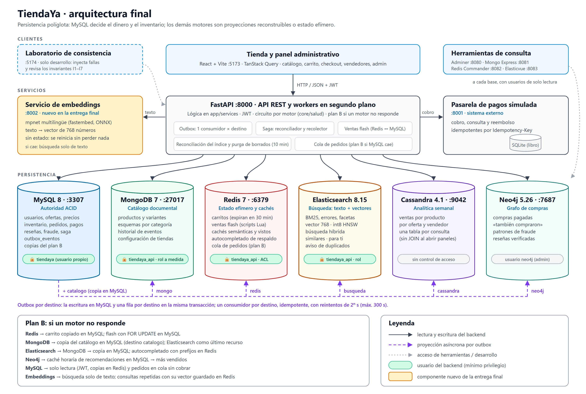

# TiendaYa — Portal de E-Commerce Políglota

Proyecto del curso **Bases de Datos 2** — UNIS, Segundo Semestre 2026.
Portal de e-commerce con arquitectura políglota: MySQL 8 para operaciones,
MongoDB 7 para el catálogo, Redis 7 para datos efímeros, Elasticsearch 8.15 para
la búsqueda (texto y vectores), Cassandra 4.1 para analítica temporal y Neo4j 5
para compras, recomendaciones y detección de fraude.

## Arquitectura final



```
React (Vite) → FastAPI (Python) → MySQL 8  (usuarios, ofertas, pedidos, inventario, pagos, outbox)
                                → MongoDB 7 (catálogo documental, eventos)
                                → Redis 7   (carritos con expiración, ventas flash, cachés semánticas)
                                → Elasticsearch 8.15 (búsqueda híbrida: texto + vectores)
                                → Cassandra 4.1 (ventas y tendencias semanales)
                                → Neo4j 5   (compras, «también compraron» y fraude)
                                → Servicio de embeddings :8002 (texto → vector, modelo local)
                                → Pasarela de pagos simulada (saga del checkout)
```

Las vistas, responsabilidades y decisiones están en
[`docs/05-diagrama-arquitectura.md`](docs/05-diagrama-arquitectura.md); la revisión de
qué se sostendría y qué se replantearía, en la [retrospectiva](docs/49-retrospectiva.md).

## Requisitos

- Docker Desktop instalado y corriendo
- Python 3.12 (se instala automáticamente en setup si falta)
- Node.js 20+
- Git
- ~1 GB libre para el modelo de embeddings (se descarga una vez a `%LOCALAPPDATA%\TiendaYa\modelos`)

## Control de acceso y contraseñas (Entrega final)

Redis, MongoDB y Elasticsearch piden usuario y contraseña; el backend usa un usuario con
mínimo privilegio en cada uno ([ADR-005](docs/48-ADR-005-control-de-acceso.md),
[detalle](docs/47-control-de-acceso.md)). **Ninguna contraseña está en el repositorio**: se
generan al azar en `.env` y `backend/.env` (ignorados por git).

- Instalación nueva: `setup.ps1` lo hace solo.
- Equipo que ya tenía el proyecto, después de actualizar: `.\scripts\configurar-acceso.ps1`
  (adopta las contraseñas con las que se crearon tus volúmenes; no pierde datos).
- DEMO de la presentación, una sola vez: `.\scripts\configurar-acceso-demo.ps1` y
  `.\scripts\migrar-indice-demo.ps1` (índice con vectores).


## URLs del sistema

Para la presentación con los **datos sintéticos de la DEMO original**, usar
[`scripts/start-presentation.ps1`](scripts/start-presentation.ps1) y, al terminar,
`scripts/stop-presentation.ps1`. La tienda queda en `:5173`, el laboratorio original en
`:5174`, la API en `:8000`, la pasarela simulada en `:8001` y el servicio de embeddings en
`:8002`. El procedimiento, el apagado seguro y sus límites están en
[la guía de presentación](docs/42-presentacion-entrega3.md). Los puertos de motores y
herramientas indicados abajo corresponden al entorno de desarrollo PRINCIPAL; no
identifican por sí solos la DEMO.

| Servicio | URL |
|---|---|
| Frontend | http://localhost:5173 |
| API Docs (Swagger) | http://localhost:8000/docs |
| Adminer (MySQL) | http://localhost:8080 |
| Mongo Express | http://localhost:8081 |
| Redis Commander | http://localhost:8082 |
| Cassandra CQL | localhost:9042 |
| Neo4j Browser | http://localhost:7474 (usuario `neo4j`, contraseña `NEO4J_PASSWORD` de `.env`) |
| Elasticsearch | http://localhost:9200 (requiere usuario) |
| Elasticvue (interfaz de Elasticsearch) | http://localhost:8083 |
| Servicio de embeddings | http://127.0.0.1:8002/health (lo levanta `start-dev.ps1`) |
| Pasarela de pagos simulada | http://127.0.0.1:8001/docs (la levanta `start-dev.ps1`) |
| Laboratorio de consistencia (solo desarrollo) | http://localhost:5174 — ver [`laboratorio/README.md`](laboratorio/README.md) |

Mongo Express, Redis Commander y Elasticvue entran con usuarios de **solo lectura**. Adminer
pide la contraseña de MySQL (`MYSQL_PASSWORD` de `.env`).

## Credenciales de prueba

| Rol | Email | Contraseña |
|---|---|---|
| Administrador | admin@tiendaya.gt | password123 |
| Comprador | comprador1@gmail.com | password123 |
| Vendedor | vendedor1@tiendaya.gt | password123 |

> **IMPORTANTE**: La contraseña `password123` ya está hasheada con bcrypt en el seed SQL. No es necesario cambiarla para las pruebas.

## Estructura del proyecto

```
proyecto/
├─ docker-compose.yml          # MySQL, MongoDB, Redis, Cassandra, Neo4j e interfaces
├─ database/
│  ├─ mysql/                   # DDL, índices, seed y migraciones versionadas
│  ├─ mongo/                   # Init collections, índices, ejemplos aggregation
│  ├─ cassandra/               # Esquema orientado a consultas analíticas
│  └─ elasticsearch/           # Mapping versionado del índice de búsqueda
├─ backend/                    # FastAPI + Python
│  ├─ app/
│  │  ├─ api/v1/               # Endpoints REST
│  │  ├─ services/             # checkout_service, catalog_service, product_history_service
│  │  └─ models/               # SQLAlchemy ORM
│  └─ scripts/                 # migrate, seed_events, verify
├─ frontend/                   # React + Vite
│  └─ src/pages/               # CatalogPage, ProductDetailPage, AdminPage, ProductHistoryPage...
├─ docs/                       # ADRs, diagramas, informe
└─ scripts/                    # setup.ps1, start-dev.ps1, reset-db.ps1
```

## Comandos útiles

```powershell
# Instalación completa desde cero, incluidas todas las extensiones vigentes
.\scripts\setup.ps1

# Iniciar TiendaYa
.\scripts\start-dev.ps1

# Verificar integridad
cd backend
.\venv\Scripts\python.exe scripts\verify_setup.py

# Correr pruebas
.\venv\Scripts\python.exe -m pytest tests -q

# Verificar los invariantes de consistencia (sin sobreventa, cobros ↔ pedidos, proyecciones...)
.\venv\Scripts\python.exe scripts\verificar_consistencia.py

# Comparar la búsqueda anterior (MongoDB) con Elasticsearch
.\venv\Scripts\python.exe scripts\comparar_busqueda.py

# Índice de búsqueda: sincronizar, recrear sin caída o reconciliar lo desfasado.
# Crear el índice o mover el alias es del usuario indexador (el backend no puede):
#   $env:ES_USERNAME = 'tiendaya_indexador'; $env:ES_PASSWORD = '<ES_INDEXADOR_PASSWORD del .env raíz>'
.\venv\Scripts\python.exe scripts\reindex_search.py
.\venv\Scripts\python.exe scripts\reindex_search.py --recrear
.\venv\Scripts\python.exe scripts\reindex_search.py --diff

# Evidencia del control de acceso: 40 intentos permitidos y prohibidos → docs\evidencia\permisos.md
.\venv\Scripts\python.exe scripts\verificar_permisos.py

# Calidad de la búsqueda por vectores y benchmark de escala (100k / 1M; este último con el indexador)
.\venv\Scripts\python.exe scripts\evaluar_vectores.py
.\venv\Scripts\python.exe scripts\benchmark_vectores.py --n 100000

# Compilar frontend
cd ..\frontend
npm run build

# Reinicializar todos los datos (operación destructiva)
cd ..
.\scripts\reset-db.ps1
```

`setup.ps1` y `start-dev.ps1` levantan y verifican Redis, y ejecutan de forma
idempotente la migración de carritos SQL heredados. El carrito activo vive en
Redis durante 30 minutos de inactividad. En el checkout, Redis aporta las
ofertas y cantidades elegidas; MySQL vuelve a validar y bloquear precio,
estado e inventario antes de guardar el pedido definitivo.

También esperan a Cassandra, crean su esquema y reconstruyen sus proyecciones
analíticas de forma idempotente. Cassandra solo recibe ventas cuyo pago ya fue
confirmado; los reembolsos se conservan separados para reportar ingresos
brutos, reembolsados y netos. Si Cassandra no está disponible, el checkout
sigue confirmándose en MySQL y el evento pendiente se reintenta mediante el
outbox. Consulte [`docs/26-decision-grafos-columnar.md`](docs/26-decision-grafos-columnar.md)
y [`docs/27-analitica-cassandra.md`](docs/27-analitica-cassandra.md).

La migración de Fase 1 no elimina datos. Antes de crear las nuevas claves
foráneas comprueba que no existan referencias huérfanas y aborta si encuentra
alguna. Las instalaciones nuevas la ejecutan automáticamente mediante Docker.

La Fase 3 conserva el modelo anterior y llena en paralelo ofertas, precios,
relaciones de inventario, subpedidos por vendedor y snapshots históricos. Es
idempotente: puede repetirse sin duplicar filas.

La Fase 5 hace que MySQL sea la autoridad de precio e inventario. Cada cambio
genera un mensaje transaccional y el worker del backend actualiza de forma
idempotente la proyección del catálogo en MongoDB. Consulte
[`docs/12-fase5-outbox.md`](docs/12-fase5-outbox.md) para ver las garantías y
la evidencia de pruebas.

La Fase 6A retiró la dependencia operativa de los campos duplicados de la tabla
SQL `productos`. Consulte
[`docs/13-fase6a-retiro-logico.md`](docs/13-fase6a-retiro-logico.md) para ver
la preparación previa al corte físico.

La parte aditiva de Fase 6B creó `producto_referencias` y migró reseñas y
movimientos hacia FKs definitivas. El corte físico posterior retiró la tabla
SQL descriptiva `productos`, `producto_imagenes`, las columnas operativas
`producto_id` y el procedimiento de checkout antiguo. Consulte
[`docs/14-fase6b-aditiva.md`](docs/14-fase6b-aditiva.md) y
[`docs/15-fase6b-corte-fisico.md`](docs/15-fase6b-corte-fisico.md).

La extensión de integridad de la Fase 7 enlaza categorías, referencias de
producto y ofertas mediante FKs. En una base ya existente se aplica y valida
con `scripts\complete-phase7-reference-integrity.ps1`. La evidencia está en
[`docs/16-fase7-integridad-referencias.md`](docs/16-fase7-integridad-referencias.md).

La extensión posterior vuelve a incorporar las imágenes binarias bajo la
identidad mínima `producto_referencias` (ya no bajo la tabla eliminada
`productos`) y permite varias categorías por producto. `setup.ps1` aplica la
migración `12_catalog_images_categories.sql` de forma automática e idempotente.
Los detalles y casos de prueba están en
[`docs/20-imagenes-categorias-ofertas.md`](docs/20-imagenes-categorias-ofertas.md).

La migración `13_catalog_requests.sql` incorpora el flujo controlado para que
los vendedores propongan productos u ofertas sin publicarlos directamente. El
administrador aprueba o rechaza cada solicitud y el vendedor conserva historial
y notificaciones. Consulte
[`docs/21-solicitudes-catalogo-vendedores.md`](docs/21-solicitudes-catalogo-vendedores.md).

La migración `15_dynamic_variants.sql` agrega variantes con atributos dinámicos
en MongoDB y un registro relacional mínimo para que cada oferta tenga una FK a
la combinación exacta que vende. Se instala automáticamente con `setup.ps1`.
Consulte [`docs/22-variantes-dinamicas.md`](docs/22-variantes-dinamicas.md).

## Documentación vigente

- [Modelo relacional definitivo](docs/01-modelo-relacional.md)
- [Diagrama ER definitivo](docs/02-diagrama-ER.md)
- [Arquitectura](docs/05-diagrama-arquitectura.md)
- [Referencias MySQL–MongoDB](docs/07-referencia-sql-mongo.md)
- [Informe de Entrega 1](docs/informe-entrega1.md)
- [Plan y evidencia de migración](docs/09-plan-migracion-incremental.md)
- [Evidencia de integridad de referencias](docs/16-fase7-integridad-referencias.md)
- [Pruebas funcionales integrales](docs/17-pruebas-funcionales.md)
- [Guía de revisión para el equipo](docs/18-guia-revision-companeros.md)
- [Correcciones del flujo de instalación](docs/19-correcciones-instalacion.md)
- [Imágenes SQL, categorías múltiples y revisión de ofertas](docs/20-imagenes-categorias-ofertas.md)
- [Solicitudes de catálogo de vendedores](docs/21-solicitudes-catalogo-vendedores.md)
- [Variantes dinámicas de producto](docs/22-variantes-dinamicas.md)
- [Paneles, envíos parciales y solicitudes de variantes: instalación y pruebas](docs/23-paneles-envios-solicitudes-variantes.md)
- [Carrito activo, concurrencia y checkout con Redis](docs/24-carrito-redis.md)
- [Ventas flash por vendedor con reservas atómicas](docs/25-ventas-flash.md)
- [Decisión entre grafos y base columnar](docs/26-decision-grafos-columnar.md)
- [Analítica temporal con Cassandra](docs/27-analitica-cassandra.md)
- [Línea base de la Entrega 3](docs/evidencia/linea-base-entrega3.md)
- [Comparación de búsqueda MongoDB vs Elasticsearch](docs/evidencia/busqueda-comparacion.md)
- [Informe de Entrega 3](docs/informe-entrega3.md)
- [ADR-003: motor de búsqueda](docs/28-ADR-003-motor-busqueda.md)
- [Búsqueda con Elasticsearch: detalle técnico](docs/29-busqueda-elasticsearch.md)
- [Estrategia de consistencia del checkout distribuido](docs/30-estrategia-consistencia-checkout.md)
- [Plan B entre bases de datos: qué hace la tienda cuando se cae un motor](docs/44-plan-b-respaldos-entre-bases.md)
- [Evidencia de las pruebas de falla](docs/31-evidencia-pruebas-falla.md)
- [Informe de la Entrega final](docs/informe-entrega4.md)
- [ADR-004: componente vectorial](docs/45-ADR-004-busqueda-vectorial.md)
- [Vectores: implementación](docs/46-vectores-implementacion.md)
- [Evaluación de la búsqueda por vectores](docs/evidencia/evaluacion-vectores.md) y [escala con 100k y 1M vectores](docs/evidencia/escala-vectores.md)
- [Control de acceso en Redis, MongoDB y Elasticsearch](docs/47-control-de-acceso.md)
- [ADR-005: control de acceso](docs/48-ADR-005-control-de-acceso.md) y [evidencia de permisos](docs/evidencia/permisos.md)
- [Retrospectiva de la arquitectura](docs/49-retrospectiva.md)

El checkout es una saga con una pasarela de pagos externa simulada
(`payment_simulator/`): reserva el inventario, cobra fuera de la transacción y
después confirma o compensa. Cambiar el comportamiento de la pasarela para
probar fallas:

```powershell
Invoke-RestMethod -Method Post http://127.0.0.1:8001/control -ContentType 'application/json' -Body '{"modo":"rechazar"}'
# modos: aprobar, rechazar, timeout, cobrar_y_fallar, error_antes
```

Para provocar fallas y observar la recuperación existe el **laboratorio de
consistencia** (`laboratorio/`, puerto 5174): una herramienta de desarrollo
aparte de la tienda, que se conecta al backend solo por su API. Requiere
`FAULT_INJECTION_ENABLED=true` en `backend/.env`; sin esa bandera el backend ni
siquiera registra sus endpoints. La evidencia reproducible de las pruebas de
falla está en [`docs/31-evidencia-pruebas-falla.md`](docs/31-evidencia-pruebas-falla.md).

La búsqueda de productos está en `GET /api/v1/search` (texto libre con
tolerancia a errores, sinónimos, relevancia y facetas) y
`GET /api/v1/search/suggest` (autocompletado). Si Elasticsearch no responde,
ambas continúan sobre MongoDB y lo indican con `degradado: true`.

Desde la Entrega final la búsqueda es **híbrida**: además del texto, el significado
(«algo para escuchar música sin cables» encuentra audífonos). Con los mismos vectores, la
página de producto muestra «También te podría interesar:», el inicio «Te podría interesar»
y las solicitudes de catálogo avisan de posibles duplicados
([detalle](docs/46-vectores-implementacion.md)).

## Entregas del proyecto

| Entrega | Estado | Contenido |
|---|---|---|
| **Entrega 1** | **Completada** | MySQL normalizado + migración a MongoDB + historial por eventos |
| **Entrega 2** | **Completada** | Redis (carrito y ventas flash) + comparación grafos/columnar + Cassandra (tendencias) y Neo4j (fraude en reseñas) |
| **Entrega 3** | **Completada** | Elasticsearch (tolerancia, relevancia y facetas) + checkout como saga con pasarela externa, outbox por destino y pruebas de falla ([informe](docs/informe-entrega3.md)) |
| **Entrega final** | **Completada** | Vectores en Elasticsearch con servicio de embeddings propio (búsqueda híbrida, similares, «Te podría interesar», duplicados) + control de acceso en Redis, MongoDB y Elasticsearch + diagrama final y retrospectiva ([informe](docs/informe-entrega4.md)) |
