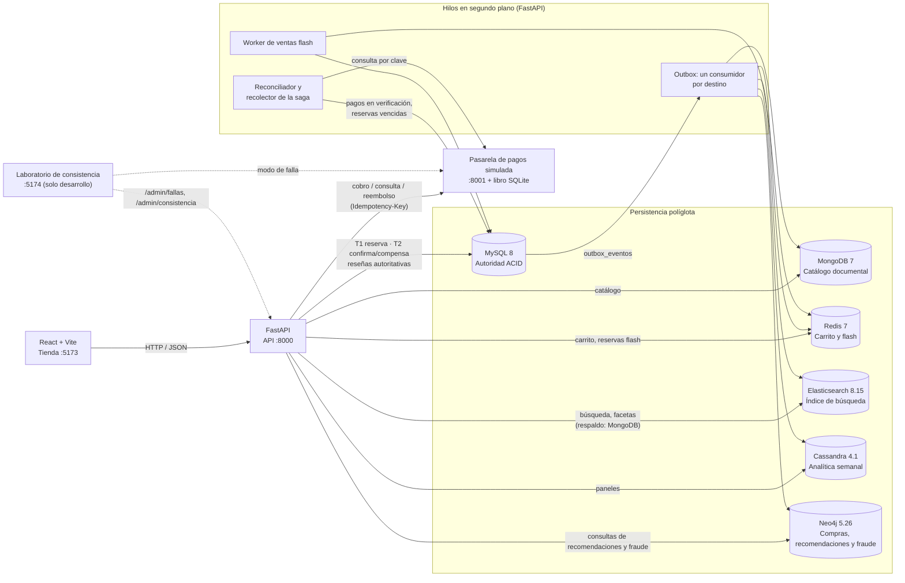

# Diagrama de Arquitectura — TiendaYa

## Arquitectura actual (cierre de Entrega 3)

## Responsabilidad por motor

| Componente | Autoridad y propósito |
|---|---|
| MySQL | Usuarios, vendedores, ofertas, precios, inventario, pedidos, pagos, reseñas, respuestas, expedientes de fraude, bitácora de la saga y outbox. **Única fuente de verdad** transaccional |
| MongoDB | Productos, variantes, atributos e historial documental; no decide precio ni stock. Respaldo de la búsqueda |
| Redis | Carritos activos y reservas de venta flash con expiración automática |
| Elasticsearch | Proyección de búsqueda: decide qué productos y en qué orden; precio y stock mostrados se hidratan desde MySQL |
| Cassandra | Proyección analítica de ventas pagadas por producto, oferta, vendedor y semana |
| Neo4j | Proyección reconstruible de compras pagadas, ofertas, reseñas, recomendaciones y patrones de fraude |
| Pasarela simulada | Sistema externo no transaccional; cobro, consulta y reembolso idempotentes por clave |

El checkout es una **saga**: reserva el inventario en MySQL (T1), cobra en la
pasarela fuera de toda transacción y confirma o compensa (T2). La confirmación
inserta en la misma transacción una fila de outbox **por destino** (MongoDB,
Elasticsearch, Cassandra, Neo4j y Redis); cada destino tiene su propio
consumidor con reintentos exponenciales, así que una base caída no retrasa a
las demás. El reconciliador resuelve pagos con resultado desconocido y el
recolector libera las reservas de sagas interrumpidas. Neo4j recibe por outbox
el modelo `Usuario → Compra → Producto/Vendedor`, con una compra única por línea
pagada; la arista histórica `COMPRO` se mantiene únicamente durante la transición.
Detalle en
[`30-estrategia-consistencia-checkout.md`](30-estrategia-consistencia-checkout.md)
y [`29-busqueda-elasticsearch.md`](29-busqueda-elasticsearch.md).

## Decisión de la Entrega 2: grafos y columnar

Las dos necesidades analíticas de la Entrega 2 tienen patrones de acceso
opuestos, por lo que se implementó una familia para cada una:

- **Cassandra** para tendencias de venta por intervalos de tiempo. Las tablas
  están desnormalizadas por consulta para evitar JOIN y agregaciones costosas
  al abrir los paneles. Modelo físico en
  [`27-analitica-cassandra.md`](27-analitica-cassandra.md).
- **Neo4j** para recomendaciones y detección de fraude, con consultas de varios
  saltos entre cuentas, compras pagadas, vendedores, ofertas, reseñas y productos.

La justificación completa está en
[`26-decision-grafos-columnar.md`](26-decision-grafos-columnar.md).

## Decisión de la Entrega 3: motor de búsqueda

Elasticsearch como proyección de solo lectura del catálogo, con MongoDB como
respaldo. Ver [`28-ADR-003-motor-busqueda.md`](28-ADR-003-motor-busqueda.md).
