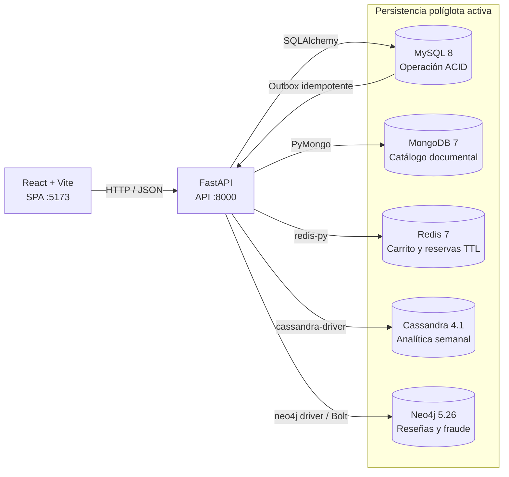

# Diagrama de Arquitectura — TiendaYa

## Arquitectura actual (cierre de Entrega 2 / inicio de Entrega 3)

## Responsabilidad por motor

| Componente | Autoridad y propósito |
|---|---|
| MySQL | Usuarios, vendedores, ofertas, precios, inventario, pedidos, pagos, solicitudes y outbox |
| MongoDB | Productos, variantes, atributos e historial documental; no decide precio ni stock |
| Redis | Carritos activos y reservas de venta flash con expiración automática |
| Cassandra | Proyección analítica de ventas pagadas por producto, oferta, vendedor y semana |
| Neo4j | Reseñas, compras verificadas (`COMPRO`) y detección de patrones de fraude |

FastAPI orquesta los cinco motores. El checkout solo depende de MySQL para
confirmar la compra: vuelve a validar y bloquear precio, estado e inventario.
Después publica eventos en el outbox dentro de la misma transacción. El worker
actualiza MongoDB o Cassandra según el tipo de evento y puede reintentar sin
duplicar resultados. La arista `COMPRO` de Neo4j todavía se escribe después del
commit con un bloque de mejor esfuerzo (sin reintento).

## Decisión de la Entrega 2: grafos y columnar

Las dos necesidades analíticas de la Entrega 2 tienen patrones de acceso
opuestos, por lo que se implementó una familia para cada una:

- **Cassandra** para tendencias de venta por intervalos de tiempo. Las tablas
  están desnormalizadas por consulta para evitar JOIN y agregaciones costosas
  al abrir los paneles. Modelo físico en
  [`27-analitica-cassandra.md`](27-analitica-cassandra.md).
- **Neo4j** para la detección de fraude en reseñas, con consultas de varios
  saltos entre cuentas, reseñas y productos.

La justificación completa está en
[`26-decision-grafos-columnar.md`](26-decision-grafos-columnar.md).

## Componentes previstos para la Entrega 3

| Componente | Rol previsto |
|---|---|
| Elasticsearch 8 | Búsqueda de texto libre con tolerancia a errores, relevancia y facetas |
| Pasarela de pagos simulada | Sistema externo, no transaccional, que vuelve explícitas las fallas parciales del checkout |
| Outbox por destino | Sincronización independiente hacia MongoDB, Elasticsearch, Cassandra, Neo4j y Redis |

Este diagrama se actualizará al cerrar la Entrega 3.
