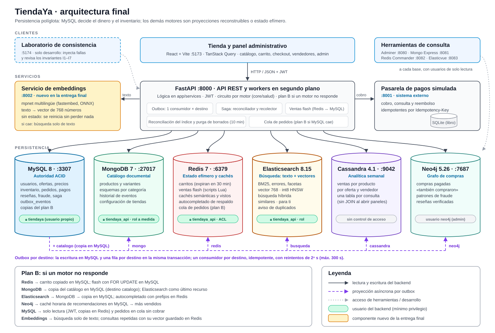
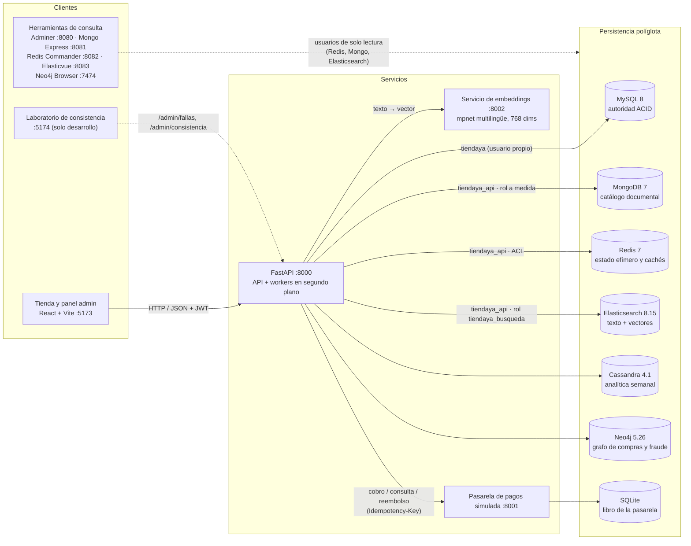
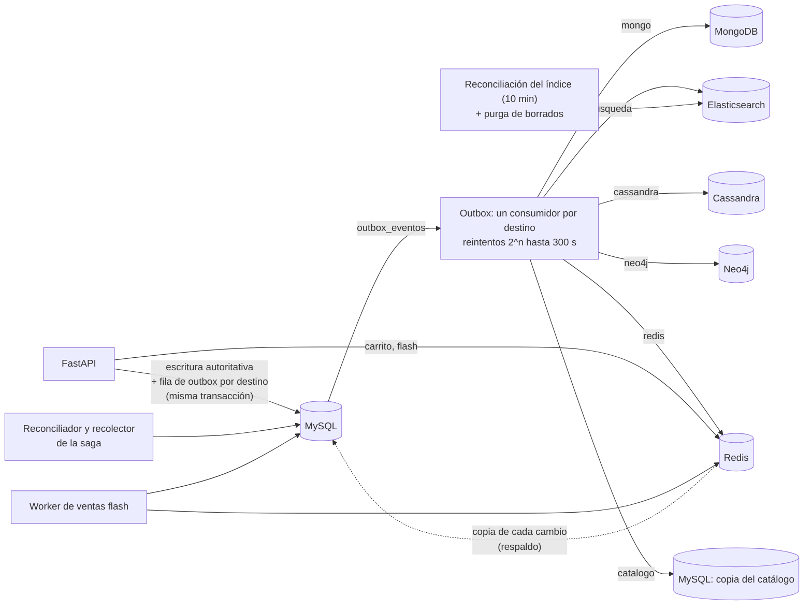
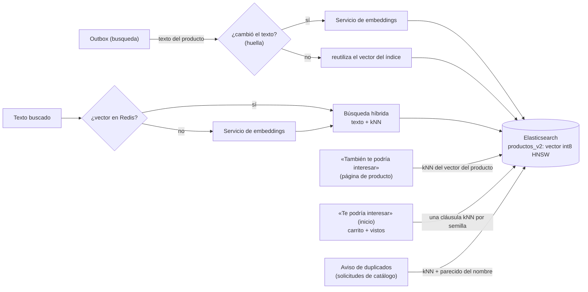

# Diagrama de Arquitectura — TiendaYa (arquitectura final)

Versión gráfica para el informe y la presentación: [`diagramas/arquitectura-final.svg`](diagramas/arquitectura-final.svg).
Abajo, la misma arquitectura en tres vistas (Mermaid, editable como texto).

## 1. Componentes y conexiones

Cada flecha hacia una base de datos indica con qué usuario se conecta ese servicio (control de acceso,
[ADR-005](48-ADR-005-control-de-acceso.md)).

| Componente | Autoridad y propósito |
|---|---|
| MySQL | Usuarios, vendedores, ofertas, precios, inventario, pedidos, pagos, reseñas, fraude, bitácora de la saga y outbox. **Única fuente de verdad** transaccional. Guarda además las copias del plan B (carritos, catálogo, recomendaciones) |
| MongoDB | Productos, variantes, esquemas de atributos por categoría, historial de eventos del producto y configuración de tiendas. No decide precio ni stock |
| Redis | Carritos con expiración, reservas de ventas flash (Lua), autocompletado de respaldo, copias de lectura y cola de pedidos del plan B, y las cachés de la búsqueda semántica (vector de cada consulta, vecinos de cada producto, «Te podría interesar», historial de vistos) |
| Elasticsearch | Proyección de búsqueda: texto (BM25, errores, sinónimos, facetas) y **vector** de cada producto (`dense_vector` int8 HNSW). Decide qué productos y en qué orden; precio y stock se hidratan desde MySQL |
| Cassandra | Proyección analítica de ventas pagadas por producto, oferta, vendedor y semana |
| Neo4j | Proyección de compras pagadas, ofertas y reseñas: «quien compró esto también compró» y patrones de fraude |
| Servicio de embeddings | Convierte texto en vectores (sin estado; se reinicia sin perder nada) |
| Pasarela simulada + SQLite | Sistema externo: cobro, consulta y reembolso idempotentes por clave |

## 2. Flujo de datos: autoridad, proyecciones y respaldos

- **Checkout como saga**: T1 reserva el inventario en MySQL, se cobra fuera de toda transacción y T2 confirma o
  compensa ([30](30-estrategia-consistencia-checkout.md)).
- **Outbox por destino**: una base caída no retrasa a las demás; los manejadores recalculan desde MySQL, así
  que son idempotentes e independientes del orden.
- **Plan B** ([44](44-plan-b-respaldos-entre-bases.md)): cuando un motor no responde, se usa otro que ya
  tiene una copia de sus datos.

| Motor caído | Respaldo |
|---|---|
| Redis | Carrito copiado en MySQL; reservas flash con `FOR UPDATE` en MySQL |
| MongoDB | Copia completa del catálogo en MySQL (destino `catalogo`); Elasticsearch como último recurso |
| Elasticsearch | MongoDB → copia del catálogo en MySQL; autocompletado con un índice de prefijos en Redis |
| Neo4j | Caché horaria de recomendaciones en MySQL → más vendidos de la categoría |
| MySQL | Solo lectura (sesión por JWT, copias de lectura en Redis) y pedidos en cola sin cobrar |
| Servicio de embeddings | Búsqueda solo de texto (las consultas ya hechas usan su vector guardado en Redis); los productos se indexan sin vector y la reconciliación los completa |

## 3. Vectores: de dónde salen y quién los usa

Detalle técnico en [46](46-vectores-implementacion.md); decisión en [ADR-004](45-ADR-004-busqueda-vectorial.md).

## Decisiones de arquitectura por entrega

| Entrega | Decisión | Documento |
|---|---|---|
| 1 | Catálogo documental en MongoDB | [ADR-001](03-ADR-001-catalogo-documental.md), [ADR-002](04-ADR-002-embeber-vs-referenciar.md) |
| 2 | Redis para carritos y flash; Cassandra para tendencias y Neo4j para recomendaciones y fraude | [26](26-decision-grafos-columnar.md), [27](27-analitica-cassandra.md) |
| 3 | Elasticsearch como proyección de búsqueda; checkout como saga con outbox por destino | [ADR-003](28-ADR-003-motor-busqueda.md), [30](30-estrategia-consistencia-checkout.md) |
| Final | Vectores en Elasticsearch con un servicio de embeddings propio | [ADR-004](45-ADR-004-busqueda-vectorial.md) |
| Final | Usuarios por servicio con mínimo privilegio en Redis, MongoDB y Elasticsearch | [ADR-005](48-ADR-005-control-de-acceso.md) |
