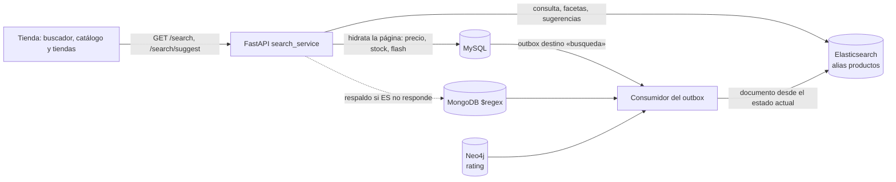

# Búsqueda de productos con Elasticsearch

Decisión y alternativas: [`28-ADR-003-motor-busqueda.md`](28-ADR-003-motor-busqueda.md).

## 1. Arquitectura

- **Elasticsearch decide qué productos y en qué orden.** La página resultante se completa
  con `catalog_service.enriquecer_productos()`: precio, stock, vendedor y promoción flash
  salen siempre de MySQL/Redis.
- **Documentos construidos desde el estado actual** (`search_index_service.construir_documentos`):
  MongoDB (nombre, descripción, categorías, atributos e imágenes, variantes), MySQL
  (ofertas, stock, flash activas, ventas) y Neo4j (rating, opcional).

## 2. Mapping deliberado (`database/elasticsearch/productos_v1.json`)

`dynamic: "strict"`: un campo no declarado es rechazado. 1 shard y 0 réplicas (un nodo).

### Analizadores

| Analizador | Cadena | Uso | Ejemplo (`_analyze`) |
|---|---|---|---|
| `es_texto` | standard → lowercase → asciifolding → stop español → stemmer `light_spanish` | Indexar nombre, descripción, categorías y atributos | `Audífonos Sony con cancelación` → `audifon, sony, cancelacion` |
| `es_texto_busqueda` | igual + `synonym_graph` | Solo al consultar | `teléfono barato` → `celular, movil, smartphon, telefon, barat` |
| `autocompletar` / `autocompletar_busqueda` | edge n-grama 2–20 al indexar; minúsculas sin tildes al consultar | Prefijos (`nombre.autocompletar`) | `Samsung` → `sa, sam, sams, …` |
| `sugeridor` | shingles de 2–3 palabras | «¿Quisiste decir…?» (`nombre.sugeridor`) | `laptop dell inspiron` → `laptop dell`, `dell inspiron`, … |
| normalizador `minusculas` | lowercase + asciifolding | SKU y orden alfabético | `TECH-LAP-001` = `tech-lap-001` |

Los sinónimos solo se aplican al consultar: cambiar la lista no obliga a reindexar el
contenido, y el índice conserva las palabras originales. Se quitó `cascos` de los sinónimos
de audífonos porque traía el casco de ciclismo.

### Campos

| Campo | Tipo | Propósito |
|---|---|---|
| `nombre` | text + `.autocompletar`, `.sugeridor`, `.orden` | Relevancia principal, prefijos, corrección, orden |
| `descripcion`, `texto_atributos` | text | Relevancia secundaria (p. ej. autor de un libro) |
| `categorias.slug` / `.nombre` | keyword / text | Filtro y faceta; relevancia por nombre de categoría |
| `atributos` | **nested** `{nombre, valor, valor_num, facetable, origen}` | Facetas variables por categoría (RAM, talla, color), incluidas las de variantes, sin crear un campo por atributo |
| `sku` | keyword normalizado | Coincidencia exacta |
| `precio` | scaled_float | **Precio mostrado** (oferta principal o flash ganadora): ordenar y filtrar igual que la vista |
| `precio_min`, `precio_max` | scaled_float | Rango de precios entre ofertas |
| `vendedores`, `vendedor_ids`, `vendedores_con_stock` | keyword / integer | Faceta de vendedor y búsqueda dentro de una tienda |
| `tiene_stock`, `es_tiendaya`, `tiene_flash`, `descuento_flash_pct` | boolean / integer | Filtros y orden por descuento |
| `ventas_totales`, `rating_promedio`, `num_resenas` | integer / float | Desempate por popularidad |
| `sugerencia` | completion | Autocompletado (nombre completo y sus sufijos: `galax` → Samsung Galaxy) |
| `indexado_en`, `fecha_actualizacion` | date | Reconciliación de lo desfasado |

## 3. Consulta (`search_service.construir_consulta`)

Un `bool` con varias estrategias en `should` (basta una):

1. **Exacta con sinónimos** (`operator: and`, peso 3) sobre nombre, categoría, atributos y descripción.
2. **Difusa** (`fuzziness: AUTO:5,8`, peso 1.5): 1 error en palabras de 5–7 letras y 2 desde 8.
   Usa el analizador sin sinónimos porque los sinónimos de varias palabras no se combinan con la difusa.
3. **Recuperación amplia** (`minimum_should_match: 1<75%`, peso 0.5): `laptop barata` encuentra laptops.
4. **Prefijo** sobre `nombre.autocompletar`.
5. **Frase** en el nombre (`slop: 2`, peso 3): premia el orden correcto.
6. **SKU exacto** (peso 20).

Todo envuelto en `function_score` (suma de `log2p(ventas)`, `ln2p(rating)` y +1 si hay
stock, multiplicado por la relevancia). Filtro fijo `estado: activo`; con `vendedor_id`,
además `vendedor_ids` (búsqueda dentro de una tienda). Ordenamientos: relevancia, precio,
nombre, recientes, más vendidos, descuento. Resaltado con `encoder: html` (el texto del
catálogo se escapa; solo se inserta `<mark>`).

## 4. Facetas disyuntivas

Los filtros elegidos por el usuario van en `post_filter`, y cada agregación se calcula
dentro de un `filter` con **todos los filtros menos el suyo**. Así, al elegir el vendedor
A, los demás vendedores conservan su conteo y se pueden combinar.

| Faceta | Agregación |
|---|---|
| Categorías | `terms` sobre `categorias.slug` |
| Vendedores | `terms` sobre `vendedores` |
| Precio | `range` (7 rangos) + `stats` |
| Disponibilidad | `filter` con stock, flash y TiendaYa |
| Atributos | `nested` → `filter facetable` → `terms nombre` → `terms valor`; cada atributo seleccionado tiene su propia agregación sin su filtro |

Las etiquetas de atributos vienen de `categoria_esquemas` (MongoDB); se ocultan los
atributos con un solo valor y los de alta cardinalidad (ISBN, autor, procesador…).

## 5. Autocompletado y corrección

- `GET /search/suggest?q=`: `completion` con `fuzzy` (`licuadroa` → Licuadora) y
  categorías cuyo nombre empieza por el texto.
- «¿Quisiste decir…?»: `phrase suggester` sobre `nombre.sugeridor` con `collate` (solo
  sugiere frases que devuelven productos, de la tienda si es una búsqueda acotada). Se omite
  cuando cada palabra es el inicio de una palabra de los resultados (`licu`, `mous`: búsqueda
  a medio escribir, no error).

## 6. Sincronización y mantenimiento

| Mecanismo | Cuándo |
|---|---|
| Outbox, destino `busqueda` | Cambios de precio, stock, ofertas, flash, ventas, reseñas, ediciones de catálogo y variantes (`encolar_reindexado`) |
| Versión externa (`external_gte`, instante de lectura en µs) | Siempre: un documento armado con datos más viejos nunca reemplaza a uno más nuevo |
| `reconciliar_desfasados` cada 10 min | Ediciones de catálogo cuyo evento no llegó a encolarse |
| `scripts/reindex_search.py` | Sin opciones: sincroniza todo · `--recrear`: índice nuevo y cambio atómico de alias · `--diff`: solo lo desfasado |
| Admin › Salud de sincronización | Reindexar diferencias o todo; ver eventos pendientes |

## 7. Respaldo

Ante `TransportError`/`ApiError` (o más de 1.5 s), `/search` responde con la búsqueda
anterior sobre MongoDB y `degradado: true`; la interfaz lo comunica. El autocompletado
también tiene respaldo. Probado con Elasticsearch detenido (escenario E11 de la
[evidencia de fallas](evidencia/fallas/README.md)).

## 8. API

| Endpoint | Parámetros |
|---|---|
| `GET /api/v1/search` | `q`, `categoria`, `vendedor` (repetible), `precio_min`, `precio_max`, `attr.<nombre>` (repetible), `solo_stock`, `solo_flash`, `solo_tiendaya`, `vendedor_id`, `orden`, `page`, `page_size` |
| `GET /api/v1/search/suggest` | `q` (≥ 2 caracteres), `limite` |

Respuesta de `/search`: `items` (hidratados con MySQL), `total`, `facetas`, `sugerencia`,
`orden`, `degradado`, `motor`, `tiempo_ms`.

## 9. Pruebas

`tests/test_search_index.py` (mapping, analizadores, construcción e indexado idempotente)
y `tests/test_search_api.py` (tolerancia, sinónimos, prefijos, SKU, resaltado seguro,
facetas disyuntivas, búsqueda por tienda, autocompletado y modo degradado).
