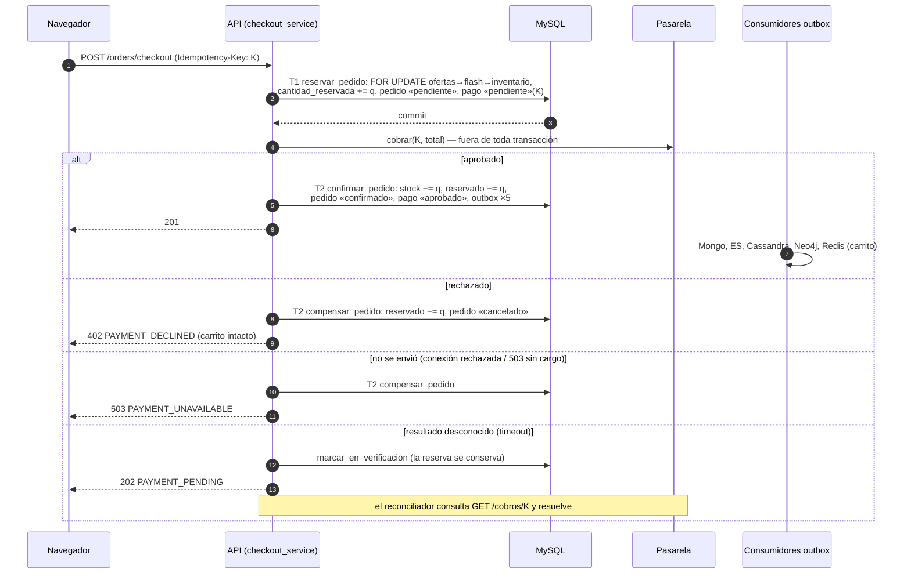
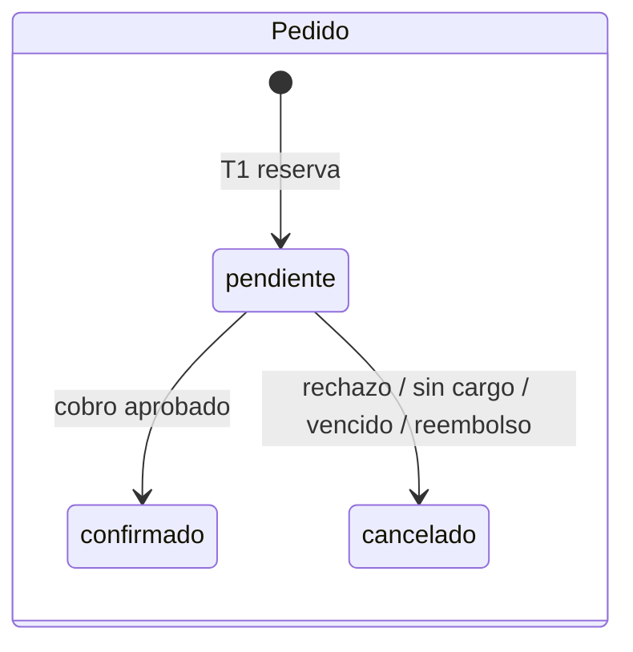
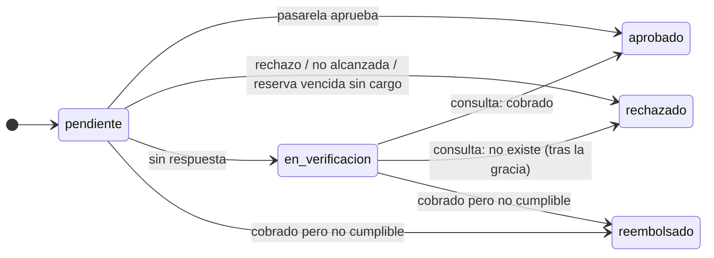
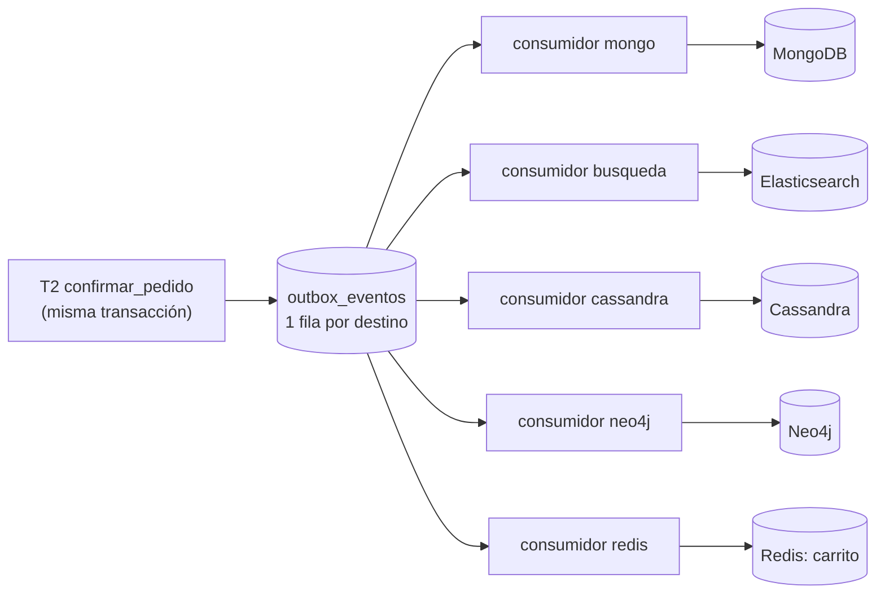

# Estrategia de consistencia del checkout distribuido

Este documento responde a la pregunta de la Entrega 3: *¿cómo garantiza TiendaYa que un
pedido no quede a medias cuando el checkout toca varias bases y un servicio externo, y
qué hace cuando una parte falla?* La evidencia de que funciona está en
[`31-evidencia-pruebas-falla.md`](31-evidencia-pruebas-falla.md).

## 1. El problema

Un checkout escribe en seis lugares que **no comparten transacción**:

| Componente | Qué cambia | Rol |
|---|---|---|
| MySQL | Pedido, subpedidos, pago, inventario, cupo flash, outbox | **Fuente de verdad** (ACID) |
| Pasarela de pagos (`payment_simulator/`, proceso aparte con su propio libro SQLite) | El cargo al cliente | Servicio externo: no participa en transacciones, solo ofrece una **clave de idempotencia** |
| Redis | Carrito y reservas flash | Estado efímero / acelerador |
| MongoDB | Stock y precio mostrados en el catálogo | Proyección |
| Elasticsearch | Documento de búsqueda (stock, ventas) | Proyección |
| Cassandra | Ventas por semana | Proyección analítica |
| Neo4j | Arista `COMPRO` (compra verificada para reseñas) | Proyección |

Una transacción distribuida clásica (2PC/XA) no es posible: la pasarela, Redis, MongoDB,
Elasticsearch, Cassandra y Neo4j no son participantes XA. Aunque lo fueran, 2PC bloquea
recursos mientras espera al coordinador y deja todo el sistema detenido si el coordinador
cae. Se eligió **consistencia fuerte solo donde importa (dinero e inventario, en MySQL)** y
**consistencia eventual con convergencia garantizada** para todo lo demás.

## 2. Garantías

| # | Garantía | Mecanismo |
|---|---|---|
| G1 | Nunca se vende más de lo que hay | Reserva con bloqueo de fila en MySQL antes de cobrar |
| G2 | Nunca se cobra dos veces la misma compra | Clave de idempotencia de punta a punta (navegador → API → pasarela) |
| G3 | Ningún pedido queda vendido sin pago aprobado, ni cobrado sin pedido | Saga con compensaciones + reconciliador contra la pasarela |
| G4 | Ningún pedido queda a medias indefinidamente | Recolector de reservas vencidas + reconciliador |
| G5 | Toda proyección converge al estado de MySQL | Outbox transaccional, consumidores por destino, proyecciones por estado |
| G6 | El usuario siempre recibe un desenlace honesto | Códigos HTTP distintos para aprobado / rechazado / desconocido / no disponible |

## 3. La saga

- **T1 y T2 son transacciones locales cortas en MySQL.** Ningún bloqueo se mantiene mientras
  se espera a la pasarela.
- **Orden único de bloqueos** (ofertas por `id` → ventas flash → inventario) en T1, T2 y en las
  compensaciones: sin interbloqueos entre checkouts concurrentes.
- **Transiciones protegidas:** toda transición bloquea el pedido con `FOR UPDATE` y solo actúa
  si sigue `pendiente`. Repetir confirmar o compensar es un no-op, así que el checkout, el
  reconciliador y el recolector pueden competir sin pisarse.
- **Bitácora:** cada paso queda en `checkout_saga_pasos` (reserva, cobro, confirmación,
  compensación, verificación, reembolso, recuperación), visible en el laboratorio y en
  `GET /admin/checkout/saga`.
- **Pago contra entrega** no pasa por la pasarela: T1 y confirmación inmediata.

### Máquinas de estado

Pago (`pagos.estado`; toda compensación lo deja en `rechazado`, salvo C4 que lo deja en `reembolsado`):

### Compensaciones

| # | Situación | Compensación | Motivo registrado |
|---|---|---|---|
| C1 | La pasarela rechaza | Liberar la reserva y cancelar; el carrito se conserva | `pago_rechazado` |
| C2 | La solicitud nunca llegó a la pasarela (conexión rechazada) | Liberar la reserva y cancelar de inmediato | `pasarela_no_disponible` |
| C3 | La pasarela confirma que el cobro no existe: tras la gracia (reconciliador) o al vencer la reserva (recolector, el proceso murió antes de cobrar) | Liberar la reserva y cancelar | `pago_no_recibido` |
| C4 | Cobro aprobado, pero el pedido ya no se puede cumplir (p. ej. oferta desactivada mientras se cobraba) | **Reembolso idempotente** en la pasarela y después C1 | `pedido_no_cumplible` |

Si el reembolso tampoco obtiene respuesta, el pedido queda `en_verificacion` y el
reconciliador lo reintenta (el reembolso también usa la clave `K`).

## 4. Idempotencia

| Nivel | Mecanismo |
|---|---|
| Navegador | `CheckoutPage` genera una clave por intento (`sessionStorage`, ligada al contenido del carrito): un doble clic o un reintento tras un error de red reutiliza la misma clave |
| API | `pedidos.clave_idempotencia` es `UNIQUE`. Reintento con la misma clave → **200** con el mismo pedido (`Idempotent-Replayed: true`); mientras se procesa → 409 `CHECKOUT_IN_PROGRESS` o 202 si está en verificación; misma clave con otro carrito (`huella_solicitud` distinta) → 422 `IDEMPOTENCY_KEY_MISMATCH`. Dos solicitudes simultáneas: la segunda choca con el índice único y recibe el resultado de la primera |
| Pasarela | La misma clave nunca genera un segundo cargo: devuelve el cargo existente |
| Un pago a la vez | Con un pago en verificación, otra compra del mismo usuario recibe 409 `PAYMENT_PENDING_EXISTS` (evita cobrar dos veces el mismo carrito con claves distintas) |
| Proyecciones | Cada destino del outbox recalcula desde el estado actual de MySQL: aplicar un evento dos veces da el mismo resultado |

## 5. Recuperación

`checkout_recovery_worker.py` corre cada `RECONCILIADOR_INTERVALO_S` (5 s):

- **Reconciliador:** pagos `en_verificacion` → `GET /cobros/K` en la pasarela.
  Cobrado → confirmar (o C4 si ya no se puede cumplir); rechazado → C1; no existe → C3 solo
  después de `RECONCILIADOR_GRACIA_S` (120 s), por si la solicitud original aún viaja.
  Pasarela caída → se reintenta en la siguiente vuelta, sin cambiar nada.
- **Recolector:** pedidos `pendiente` con `reserva_expira_en` vencida (10 min) y pago aún
  `pendiente`, es decir, el proceso murió a mitad de la saga. Consulta la pasarela con `K`
  antes de decidir: si el cargo existe confirma **sin volver a cobrar**; si no existe, C3; si la
  pasarela no responde, lo pasa a verificación para el reconciliador.

## 6. Propagación a las proyecciones (outbox)

- **Atomicidad con el negocio:** las filas del outbox se insertan en la misma transacción
  que confirma el pedido. O existen el pedido y sus eventos, o ninguno.
- **Una fila y un hilo por destino:** cada destino avanza a su ritmo. Con MongoDB detenido,
  Elasticsearch, Cassandra, Neo4j y Redis siguen al día (medido en E10–E13). La primera
  versión usaba un solo hilo y una caída de MongoDB retenía a todos (bloqueo de cabeza de
  línea); la evidencia de la primera corrida lo mostró y se corrigió.
- **Orden y concurrencia:** se reclama por `secuencia` con `SELECT … FOR UPDATE SKIP LOCKED`.
- **Reintentos:** espera exponencial `min(2^intentos, 300)` s; tras 10 intentos el evento queda
  `fallido` y se reintenta manualmente (`POST /admin/sync/outbox/reintentar` o el laboratorio).
- **Proyección por estado, no por delta:** el consumidor de MongoDB no aplica «stock −2»; lee el
  stock actual de MySQL. Un evento repetido, atrasado o fuera de orden no corrompe nada.
  Elasticsearch usa además versión externa (`external_gte`) con el instante de lectura.
- **Cassandra nunca aprueba pagos ni descuenta inventario**; solo recibe ventas confirmadas.

## 7. Matriz de fallas

| # | Falla | Desenlace | Respuesta al usuario | Prueba |
|---|---|---|---|---|
| F1 | Pasarela rechaza el pago | C1: reserva liberada, carrito intacto | 402 `PAYMENT_DECLINED` | E01 · `test_pago_rechazado_compensa_y_libera_la_reserva` |
| F2 | Pasarela cobra y responde error 500 | Reintento automático con la misma clave: la pasarela devuelve el cargo existente | 201, un solo cargo | E02 · `test_falla_despues_de_cobrar_se_resuelve_con_reintento_idempotente` |
| F3 | Pasarela no responde (timeout) | Reserva conservada, en verificación; el reconciliador resuelve | 202 `PAYMENT_PENDING` | E03 · `test_timeout_deja_el_pago_en_verificacion_y_se_resuelve_consultando` |
| F4 | La pasarela responde 503 en todos los intentos; el cargo nunca existió | En verificación; tras la gracia el reconciliador aplica C3 | 202 → cancelado sin cargo | E04 · `test_reconciliador_espera_y_luego_compensa_un_cobro_inexistente`, `test_sin_respuesta_y_sin_cargo_se_compensa_al_consultar` |
| F5 | Pasarela caída (conexión rechazada: la solicitud no salió) | C2 inmediata | 503 `PAYMENT_UNAVAILABLE` | `test_pasarela_inalcanzable_compensa_de_inmediato` |
| F6 | Caída del proceso tras reservar y antes de cobrar | Recolector: C3 al vencer la reserva | Pedido cancelado «no se recibió el pago» | E05 · `test_caida_antes_de_cobrar_libera_la_reserva_al_vencer` |
| F7 | Caída del proceso tras cobrar y antes de confirmar | Recolector consulta con `K` y confirma | Pedido confirmado | E06 · `test_caida_despues_de_cobrar_confirma_sin_volver_a_cobrar` |
| F8 | Falla dentro de la transacción de confirmación | Rollback completo (ni stock descontado ni pago aprobado); el recolector confirma con el cargo existente | 500 → pedido confirmado | E07 · `test_falla_de_la_transaccion_de_confirmacion_no_deja_nada_a_medias` |
| F9 | Doble envío / reintento del navegador | Un solo pedido, un solo cargo | 200 replay o 409 en curso | E08 · `test_misma_clave_no_crea_un_segundo_pedido`, `test_api_reintento_con_la_misma_clave_devuelve_el_mismo_pedido` |
| F10 | Misma clave con otro carrito | Rechazado | 422 `IDEMPOTENCY_KEY_MISMATCH` | `test_api_reintento_con_la_misma_clave_devuelve_el_mismo_pedido` |
| F11 | Segunda compra con un pago en verificación | Bloqueada | 409 `PAYMENT_PENDING_EXISTS` | `test_api_pago_en_verificacion_responde_202_y_bloquea_otra_compra` |
| F12 | Cobro aprobado de un pedido que ya no se puede cumplir | C4: reembolso + cancelación | 409 `ORDER_NOT_FULFILLABLE` | `test_cobro_aprobado_de_pedido_no_cumplible_se_reembolsa` |
| F13 | Precio cambió entre carrito y pago | No se reserva ni cobra | 409 `PRICE_CHANGED` | `test_checkout.py` |
| F14 | Redis no responde al iniciar el checkout | No se crea pedido ni se toca inventario; el carrito sigue intacto al volver Redis. Si Redis cae después de confirmar, la limpieza del carrito espera en el outbox | 503 `CART_UNAVAILABLE` | E09 |
| F15 | MongoDB caído | Pedido confirmado; evento `mongo` retenido; los demás destinos al día | 201 | E10 |
| F16 | Elasticsearch caído | Pedido confirmado; búsqueda degradada a MongoDB | 201 | E11 |
| F17 | Neo4j caído | Pedido confirmado; la arista `COMPRO` llega al volver | 201 | E12 |
| F18 | Cassandra caída | Pedido confirmado; la proyección analítica se pone al día | 201 | E13 |
| F19 | Un destino falla 10 veces | Evento `fallido`, reintentable sin afectar a los demás | — | `test_evento_agotado_queda_fallido_y_se_puede_reintentar` |

## 8. Invariantes verificables

`consistency_service.verificar()` (`scripts/verificar_consistencia.py`,
`GET /admin/consistencia`, laboratorio) comprueba después de cada prueba:

| ID | Invariante |
|---|---|
| I1 | Sin sobreventa: `0 ≤ cantidad_reservada ≤ cantidad_disponible` |
| I2 | Toda unidad reservada está explicada por una venta flash vigente o un pedido `pendiente` |
| I3 | Ningún pedido vendido sin pago aprobado (excepto contra entrega). Los pedidos #13, #14 y #27 del seed de la Entrega 1 se reportan como nota histórica |
| I4 | Cada pedido cancelado liberó su reserva |
| I5 | Ninguna saga atascada (pendiente con la reserva vencida, verificación muy antigua) |
| I6 | Cada cobro de la pasarela coincide con su pedido (aprobado ↔ confirmado, reembolsado ↔ cancelado) |
| I7 | MongoDB y Elasticsearch convergen con el stock de MySQL cuando no hay eventos pendientes |

## 9. Ventanas de consistencia eventual

| Proyección | Ventana normal | Con el destino caído |
|---|---|---|
| MongoDB, Elasticsearch, Cassandra, Neo4j, Redis | ~1–2 s (sondeo cada segundo) | Hasta que vuelve + espera de reintento (máx. 300 s) |
| Pago en verificación | 5 s (intervalo del reconciliador) | Hasta que la pasarela responde |
| Reserva huérfana | `CHECKOUT_RESERVA_MINUTOS` (10 min) | — |

Ninguna de estas ventanas afecta dinero ni inventario: precio y stock se validan y bloquean
en MySQL al comprar, y la búsqueda hidrata precio y stock desde MySQL.

## 10. Riesgos aceptados

- **Ventanas de inconsistencia visibles** en catálogo, búsqueda y analítica (segundos).
- **Reserva retenida** hasta 10 min si el proceso muere antes de cobrar.
- **El usuario puede ver «pago en verificación»** unos segundos; la página del pedido se
  actualiza sola.
- **Ediciones de catálogo** se escriben en MongoDB antes de encolar su evento en MySQL; la
  reconciliación cada 10 min cubre la caída entre ambos pasos.
- **Un nodo por motor**: no hay réplicas; la alta disponibilidad queda fuera del alcance.

## 11. Cómo se prueba

Los puntos de falla (`checkout.despues_reserva`, `checkout.despues_cobro`,
`checkout.confirmacion`, `outbox.<destino>`) y los modos de la pasarela solo existen con
`FAULT_INJECTION_ENABLED=true`; sin la bandera el backend ni siquiera registra esos
endpoints. Se controlan desde el **laboratorio de consistencia** (`laboratorio/`, puerto
5174) o desde `scripts/demo_fallas.py`, que ejecuta los escenarios E00–E13 y genera la
evidencia en [`evidencia/fallas/`](evidencia/fallas/README.md).
