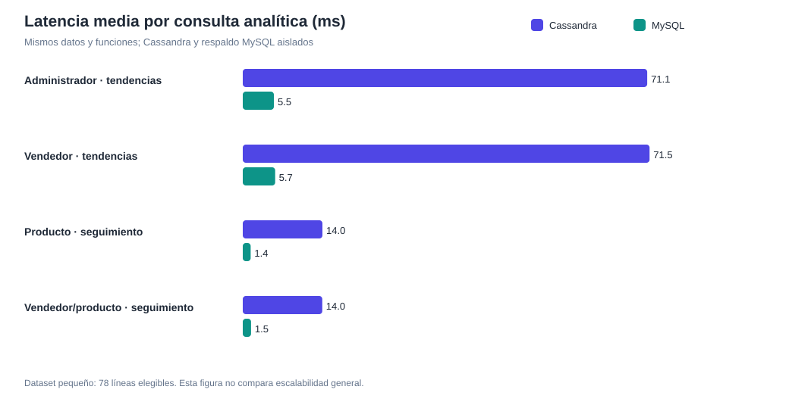
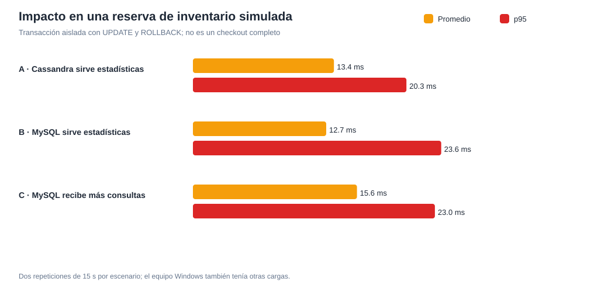

# Benchmark aislado: Cassandra frente al respaldo MySQL

**Fecha:** 1 de noviembre de 2026. **Estado:** medición local completada para las
consultas analíticas y un proxy de inventario; checkout completo y punto de
saturación real pendientes de un entorno aislado de seis motores.

## Entorno y método

- Rama `feature/ferxo-cassandra-planb-outbox`, base
  `d05920e5cb402992e476a68fbefe00fd446a9d0a`.
- PRINCIPAL permaneció en sus puertos y volúmenes originales. El benchmark usó
  solo los contenedores `tiendaya_benchmark_mysql` (127.0.0.1:3337,
  límite 768 MiB) y `tiendaya_benchmark_cassandra` (127.0.0.1:9242,
  límite 2 GiB, heap 512 MiB), con volúmenes nuevos y separados.
- MySQL se restauró de un respaldo previamente verificado, se aplicaron las
  migraciones 24–27 en la copia y se reconstruyó allí el respaldo analítico.
  Cassandra se reconstruyó desde esa copia, sin consultar ni escribir la
  Cassandra PRINCIPAL. Snapshot inicial: 40 pedidos, 40 pagos, 85 líneas;
  78 líneas elegibles en 23 semanas. Las pruebas sintéticas posteriores están
  únicamente en la copia benchmark.
- Se midieron **las funciones de servicio** que usan los endpoints de
  administrador y vendedor, con las mismas semanas, vendedor y producto en
  ambas fuentes. No se incluye HTTP, autenticación, renderizado ni consulta
  adicional a MongoDB para el filtro «sin ventas».
- Cada ejecución calentó ambas fuentes con tres consultas. `admin_trends` tuvo
  cinco corridas de 50 consultas por fuente; las otras tres, tres corridas de
  50 por fuente. Los percentiles de la tabla son el promedio de los percentiles
  de cada corrida, no percentiles agrupados de todas las muestras.
- Windows tenía 31.11 GiB de RAM física y 8.92 GiB libres antes de iniciar los
  dos motores. Con ambos activos se midieron aproximadamente 7.2–7.9 GiB
  libres. TiendaYa PRINCIPAL y otras aplicaciones seguían funcionando; los
  tiempos están sujetos a ruido de escritorio y a la caché del sistema.

Los comandos reproducibles y sus límites de seguridad están en
[`benchmarks/compose.planb.yml`](../benchmarks/compose.planb.yml),
[`benchmark_cassandra_planb.py`](../backend/scripts/benchmark_cassandra_planb.py)
y [`planb_load.py`](../benchmarks/planb_load.py). Los JSON y CSV crudos están
en [`benchmarks/results/20261101`](../benchmarks/results/20261101).

## Latencia sin carga comercial concurrente

| Consulta de servicio | Corridas × muestras/fuente | Filas | Cassandra media / p50 / p95 / p99 (ms) | MySQL media / p50 / p95 / p99 (ms) | Diferencia de media MySQL |
|---|---:|---:|---:|---:|---:|
| Administrador, tendencias con 4 semanas previas | 5 × 50 | 26 | 71.08 / 71.71 / 74.20 / 75.41 | 5.47 / 5.40 / 6.36 / 6.73 | −92.3 % |
| Vendedor, ofertas con 4 semanas previas | 3 × 50 | 18 | 71.50 / 71.58 / 73.39 / 74.44 | 5.69 / 5.56 / 7.01 / 7.90 | −92.0 % |
| Seguimiento semanal de un producto | 3 × 50 | 5 | 14.00 / 14.00 / 15.71 / 16.37 | 1.39 / 1.32 / 1.78 / 2.27 | −90.1 % |
| Seguimiento semanal de un producto/vendedor | 3 × 50 | 5 | 13.97 / 14.02 / 15.68 / 16.38 | 1.45 / 1.36 / 2.14 / 2.36 | −89.6 % |

**Resultados:** las cuatro consultas devolvieron las mismas métricas por
producto, vendedor y semana en todas las corridas. La imagen decorativa se
excluyó de la comparación. El resultado favorable a MySQL en este dataset
pequeño **no demuestra** que sea mejor con millones de líneas o más nodos.
La comparación previa de las 23 semanas de datos reales derivados también
arrojó cero diferencias en las tres proyecciones.

## Carga simultánea A/B/C

Para observar interferencia transaccional se ejecutaron dos hilos que bloquean
y actualizan **filas distintas** de inventario y hacen `ROLLBACK` en cada
iteración. Es un proxy limitado de reserva, no el checkout completo: no incluye
carrito, pasarela, pedido, saga ni Outbox. Cada escenario se repitió dos veces
con una duración objetivo de 15 s y la misma semana analítica.

| Escenario | Analítica concurrente | QPS analítica | Latencia analítica media / p95 (ms) | QPS proxy inventario | Latencia proxy media / p50 / p95 / p99 (ms) |
|---|---|---:|---:|---:|---:|
| A: Cassandra sirve estadísticas | 2 hilos | 35.58 | 50.58 / 77.06 | 140.78 | 13.40 / 12.17 / 20.29 / 34.96 |
| B: MySQL sirve estadísticas | 2 hilos | 312.60 | 5.80 / 7.30 | 143.39 | 12.67 / 10.62 / 23.59 / 41.95 |
| C: MySQL recibe más analítica | 6 hilos | 260.23 | 20.11 / 24.58 | 113.20 | 15.59 / 14.57 / 22.99 / 39.09 |

Frente a B, C elevó la media del proxy de inventario **23.1 %** y redujo su
ritmo **21.1 %**. El p95 varió entre repeticiones y no siguió un patrón
monótono. A y B tampoco permiten atribuir toda diferencia al motor: la máquina
compartía CPU con PRINCIPAL y Windows. El descenso de QPS analítica en C pese
a más hilos puede deberse también al cliente Python o a la contención local;
**no se identificó un punto de saturación de MySQL**.

Durante A, el pico de CPU observado por `docker stats` fue 27.6 % para MySQL y
101.5 % para Cassandra (un núcleo aproximado). Durante B, MySQL llegó a
48.4 %, y durante C a 44.1 %. Sus picos de memoria fueron 440.4, 443.7 y
444.4 MiB respectivamente. Cassandra llegó a unos 1,195 MiB. Ninguna de las
seis corridas registró aumento de `Slow_queries` ni de
`Innodb_row_lock_waits`; una prueba corta posterior observó un máximo de nueve
conexiones MySQL. Los muestreos de CPU son instantáneos y no equivalen a CPU
promedio de toda la corrida.

El almacenamiento medido tras las pruebas fue 233,059,889 bytes en el volumen
MySQL y 67,957,106 bytes en Cassandra. **No es una comparación de eficiencia
de almacenamiento:** MySQL contiene todo el snapshot comercial y Cassandra
solo la proyección analítica. La diferencia del tamaño de los volúmenes no se
interpreta como ahorro atribuible a una tecnología.

## Actualización, sincronización y límites

En la copia se crearon compras sintéticas pagadas y se procesaron sus dos
destinos analíticos de Outbox. La primera proyección y comparación tardó
aproximadamente 1.90 s; la flash, 0.47 s. Son observaciones puntuales que
incluyen arranque de conexiones y verificación, no latencia de producción.
Al detener solo Cassandra benchmark, la fila Cassandra pasó a `error`, la de
MySQL a `procesado` y MySQL continuó respondiendo. Tras reiniciar Cassandra,
el reintento terminó `procesado`; el tiempo total observado de caída,
reinicio y convergencia fue 21.58 s, sin diferencia final. Detalle en
[`consistencia.json`](../benchmarks/results/20261101/consistencia.json).

**Conclusión:** el Plan B ofrece continuidad analítica y resultados correctos
en este tamaño de datos. La prueba no certifica latencia del checkout real ni
escalabilidad. Una prueba de seis motores aislados, con mayor volumen y
clientes HTTP concurrentes, debe ejecutarse por turnos o en otra máquina;
montarla junto a PRINCIPAL reduciría demasiado la RAM libre. No se cambió la
arquitectura del Outbox ni se borraron eventos.
